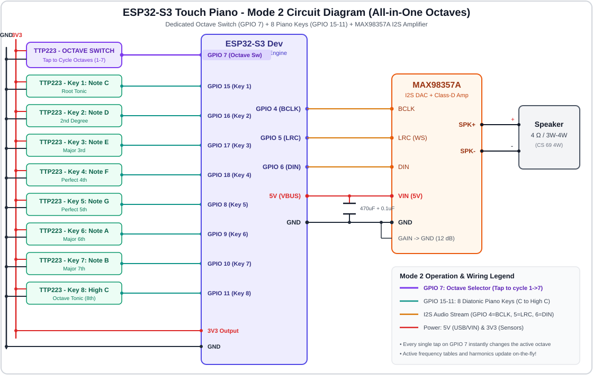
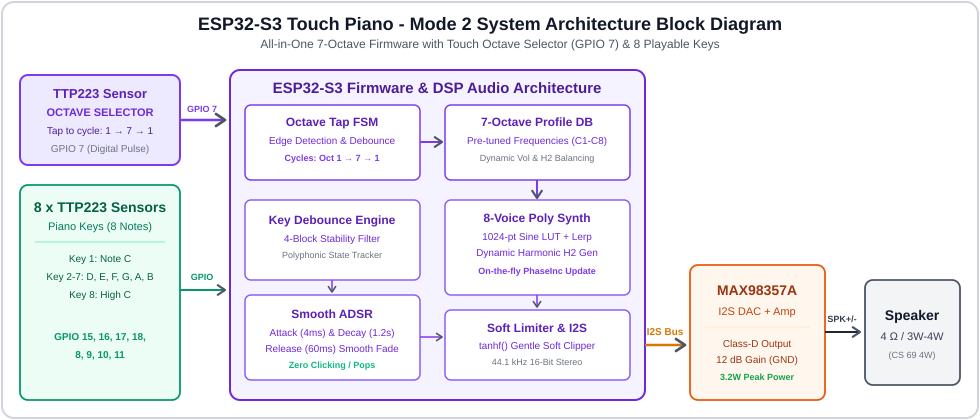
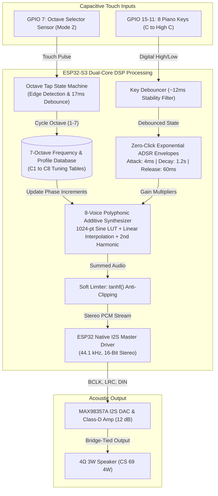
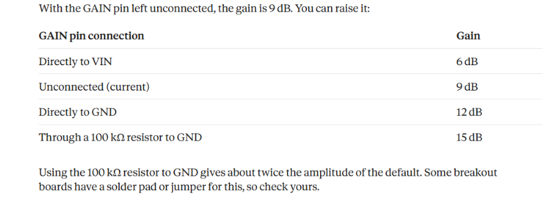

# 🎹 ESP32-S3 Polyphonic Touch Piano (Modes 1 & 2)

An open-source, touch-synthesized electronic piano built with the **ESP32-S3**, **TTP223 capacitive touch sensors**, and the **MAX98357A I2S Class-D amplifier**. 

Features real-time additive sine synthesis, an 8-voice polyphonic audio engine, click-free exponential ADSR envelopes, hyperbolic-tangent soft limiting, and digital 44.1 kHz 16-bit I2S audio output.

---

## 📸 System Schematics & Architecture

### 🔌 Circuit Diagram (Version 2)


### 🧩 System Block Diagram


---

## 🌟 Operating Modes Overview

This repository is organized into two complete, independent modes:

```
ESP32-S3-Touch-Piano/
├── README.md                                    # Overall project guide & specifications
├── .gitignore                                   # Git ignore rules
│
├── Version_1/                                   # VERSION 1: 7 Separate Octave Sketches
│   ├── piano_octave1/piano_octave1.ino          # Octave 1: C1 to C2 (32.70 Hz - 65.41 Hz)
│   ├── piano_octave2/piano_octave2.ino          # Octave 2: C2 to C3 (65.41 Hz - 130.81 Hz)
│   ├── piano_octave3/piano_octave3.ino          # Octave 3: C3 to C4 (130.81 Hz - 261.63 Hz)
│   ├── piano_octave4/piano_octave4.ino          # Octave 4: C4 to C5 (261.63 Hz - 523.25 Hz - Mid C)
│   ├── piano_octave5/piano_octave5.ino          # Octave 5: C5 to C6 (523.25 Hz - 1046.50 Hz)
│   ├── piano_octave6/piano_octave6.ino          # Octave 6: C6 to C7 (1046.50 Hz - 2093.00 Hz)
│   ├── piano_octave7/piano_octave7.ino          # Octave 7: C7 to C8 (2093.00 Hz - 4186.01 Hz)
│   ├── circuit_diagram.svg                      # Version 1 wiring diagram
│   ├── block_diagram.svg                        # Version 1 architecture
│   └── README.md                                # Version 1 detailed documentation
│
└── Version_2/                                   # VERSION 2: Unified Multi-Octave Engine
    ├── piano_all_octaves_touch_select.ino       # Single firmware with all 7 octaves
    ├── piano_all_octaves_touch_select/          # Arduino IDE compatible sketch folder
    │   └── piano_all_octaves_touch_select.ino
    ├── circuit_diagram.svg                      # Version 2 wiring diagram (GPIO 7 Octave Switch)
    ├── block_diagram.svg                        # Version 2 FSM architecture
    └── README.md                                # Version 2 detailed documentation
```

### 🎵 Mode 1: Individual Octave Sketches (7 Separate Codes)
- **7 Independent Firmware Sketches:** One sketch per octave (`piano_octave1` through `piano_octave7`).
- **Standard Diatonic Octave (8 Keys):** Plays exactly 8 notes from Root C to High C (e.g. C4 to C5). The extra non-standard 9th key (D7 / D) has been removed.
- **Dedicated Testing:** Perfect for isolating and benchmarking the acoustic response of each octave individually.

### 🚀 Mode 2: All-in-One Multi-Octave Engine (Single Code)
- **Single Master Sketch:** Contains all 7 octaves in one firmware.
- **Touch-Based Octave Selector (GPIO 7):** Tap the touch pad on **GPIO 7** to cycle octaves on-the-fly:
  $$\text{Octave } 1 \rightarrow 2 \rightarrow 3 \rightarrow 4 \rightarrow 5 \rightarrow 6 \rightarrow 7 \rightarrow 1 \dots$$
- **8 Playable Piano Keys (GPIO 15, 16, 17, 18, 8, 9, 10, 11):** Play whichever octave is currently active.
- **Zero-Glitch Transitions:** Dynamically updates phase increments, master volume, and harmonic weighting with zero audible clicks or pops.

---

## 📌 Hardware Pinout & Wiring Connections

| Sensor / Module Pin | ESP32-S3 Pin | Mode 1 Function | Mode 2 Function | Wire Connection |
|---|:---:|---|---|---|
| **TTP223 Sensor 1** | **GPIO 7** | *Unused (Reserved)* | **🔄 Octave Selector (Tap to cycle 1-7)** | I/O &rarr; GPIO 7 |
| **TTP223 Sensor 2** | **GPIO 15** | Key 1: Note C (Root Tonic) | Key 1: Note C (Root Tonic) | I/O &rarr; GPIO 15 |
| **TTP223 Sensor 3** | **GPIO 16** | Key 2: Note D (2nd Degree) | Key 2: Note D (2nd Degree) | I/O &rarr; GPIO 16 |
| **TTP223 Sensor 4** | **GPIO 17** | Key 3: Note E (Major 3rd) | Key 3: Note E (Major 3rd) | I/O &rarr; GPIO 17 |
| **TTP223 Sensor 5** | **GPIO 18** | Key 4: Note F (Perfect 4th) | Key 4: Note F (Perfect 4th) | I/O &rarr; GPIO 18 |
| **TTP223 Sensor 6** | **GPIO 8** | Key 5: Note G (Perfect 5th) | Key 5: Note G (Perfect 5th) | I/O &rarr; GPIO 8 |
| **TTP223 Sensor 7** | **GPIO 9** | Key 6: Note A (Major 6th) | Key 6: Note A (Major 6th) | I/O &rarr; GPIO 9 |
| **TTP223 Sensor 8** | **GPIO 10** | Key 7: Note B (Major 7th) | Key 7: Note B (Major 7th) | I/O &rarr; GPIO 10 |
| **TTP223 Sensor 9** | **GPIO 11** | Key 8: High C (8th Tonic) | Key 8: High C (8th Tonic) | I/O &rarr; GPIO 11 |
| **MAX98357A BCLK** | **GPIO 4** | I2S Bit Clock | I2S Bit Clock | BCLK &rarr; GPIO 4 |
| **MAX98357A LRC** | **GPIO 5** | I2S Word Select (Left/Right) | I2S Word Select (Left/Right) | LRC &rarr; GPIO 5 |
| **MAX98357A DIN** | **GPIO 6** | I2S Digital Audio Data | I2S Digital Audio Data | DIN &rarr; GPIO 6 |
| **MAX98357A VIN** | **5V (VBUS)** | Amplifier Power (&ge; 5V 2A) | Amplifier Power (&ge; 5V 2A) | VIN &rarr; 5V |
| **MAX98357A GND** | **GND** | Common Ground | Common Ground | GND &rarr; GND |
| **MAX98357A GAIN** | **GND** | **12 dB Hardware Gain** | **12 dB Hardware Gain** | GAIN &rarr; GND |
| **MAX98357A SD** | *Unconnected* | Left/Right mixed stereo | Left/Right mixed stereo | Floating |

> **Power Decoupling Tip:** Solder or connect a **470 µF – 1000 µF electrolytic capacitor** and a **0.1 µF ceramic capacitor** in parallel directly across the MAX98357A's VIN and GND pins. This eliminates supply sagging and crackling during loud chord playback.

---

## ⚙️ System Workflow



1. **Touch Sensing:** The TTP223 capacitive sensors detect finger capacitance and transition output from LOW to HIGH.
2. **Debouncing:** Digital reads are filtered across consecutive audio blocks (~12 ms) to prevent false triggering and mechanical bounce.
3. **Octave Selection (Mode 2):** When GPIO 7 is tapped, the state machine increments the octave index, updating the synthesized note frequencies immediately without interrupting currently ringing notes.
4. **Smooth Envelope Shaping:** Voices use an exponential ADSR envelope with a rapid 4 ms attack, ensuring note strikes are crisp with **zero audible clicks or pops**.
5. **Polyphonic Additive Synthesis:** Voices step through a 1024-point precomputed sine table using linear interpolation (`tableLerp`) and blend in an octave-tuned second harmonic ($H_2$) for an acoustic, piano-like timbre.
6. **Soft Limiting:** The mixed output passes through a hyperbolic tangent soft limiter (`tanhf`). This prevents digital clipping distortion when multiple notes are held together.
7. **I2S Audio Output:** Processed 44.1 kHz 16-bit stereo PCM audio is streamed over I2S to the MAX98357A for amplification to the speaker.

---

## 🎼 Complete 7-Octave Frequency Database

Standard equal temperament ($A_4 = 440\text{ Hz}$):

| Key | Note | Octave 1 | Octave 2 | Octave 3 | Octave 4 *(Default)* | Octave 5 | Octave 6 | Octave 7 |
|:---:|:---:|:---:|:---:|:---:|:---:|:---:|:---:|:---:|
| **1** | **C** | 32.70 Hz | 65.41 Hz | 130.81 Hz | **261.63 Hz** *(Mid C)* | 523.25 Hz | 1046.50 Hz | 2093.00 Hz |
| **2** | **D** | 36.71 Hz | 73.42 Hz | 146.83 Hz | **293.66 Hz** | 587.33 Hz | 1174.66 Hz | 2349.32 Hz |
| **3** | **E** | 41.20 Hz | 82.41 Hz | 164.81 Hz | **329.63 Hz** | 659.25 Hz | 1318.51 Hz | 2637.02 Hz |
| **4** | **F** | 43.65 Hz | 87.31 Hz | 174.61 Hz | **349.23 Hz** | 698.46 Hz | 1396.91 Hz | 2793.83 Hz |
| **5** | **G** | 49.00 Hz | 98.00 Hz | 196.00 Hz | **392.00 Hz** | 783.99 Hz | 1567.98 Hz | 3135.96 Hz |
| **6** | **A** | 55.00 Hz | 110.00 Hz | 220.00 Hz | **440.00 Hz** *(Concert)*| 880.00 Hz | 1760.00 Hz | 3520.00 Hz |
| **7** | **B** | 61.74 Hz | 123.47 Hz | 246.94 Hz | **493.88 Hz** | 987.77 Hz | 1975.53 Hz | 3951.07 Hz |
| **8** | **High C** | 65.41 Hz | 130.81 Hz | 261.63 Hz | **523.25 Hz** | 1046.50 Hz | 2093.00 Hz | 4186.01 Hz |


---

## 🔊 Speaker Acoustic Analysis & Amplifier Gain Recommendations

### 1. Speaker Frequency Response (CS 69 4W)


The sound pressure level (SPL) vs. frequency curve of our **CS 69 4W** speaker reveals three clear acoustic bands:
- **Sub-Bass & Bass (< 200 Hz):** SPL is naturally low (**55 dB to 72 dB**) due to the small cone size and lack of an acoustic resonant enclosure. In our firmware, an added 2nd harmonic ($H_2 = 0.35 - 0.40$) generates a psychoacoustic virtual pitch so bass notes are clearly heard.
- **Midrange & Presence (300 Hz – 3,000 Hz):** SPL rises rapidly to **85 dB – 95 dB** and hits an acoustic resonance peak of **105 dB SPL** at **1.3 kHz to 1.5 kHz**.
- **High Treble (3 kHz – 10 kHz):** Strong output (**90 dB to 100 dB**), rolling off smoothly above 12 kHz.

### 2. MAX98357A Amplifier Gain Configuration


| GAIN Pin Wiring | Voltage Gain | Effective Multiplier | Characteristics |
|---|:---:|:---:|---|
| Connected directly to **VIN** | **6 dB** | 2.0 &times; | Quiet volume; suitable for sensitive headphones |
| **Unconnected (Floating)** | **9 dB** | 2.8 &times; | Factory default; moderate loudness |
| Connected directly to **GND** | **12 dB** | **4.0 &times;** | **RECOMMENDED BEST SETTING** for 4 Ω 3W/4W speakers |
| Via **100 kΩ Resistor** to GND | **15 dB** | 5.6 &times; | Loudest, but causes USB power sagging (>1 A peak) and audio clipping |

### 🎯 Engineering Recommendations
1. **Best Amplifier Gain &rarr; 12 dB (GAIN tied directly to GND):**
   - Delivers the full 3.2 W output into a 4 Ω speaker cleanly from standard 5V USB power.
   - Requires no extra resistors (simply connect the GAIN pin to the adjacent GND pin).
   - Avoids the USB voltage brownouts and severe distortion common at 15 dB.
2. **Best Octaves for this Speaker &rarr; Octave 4 & Octave 5 (Secondary: Octave 6):**
   - **Octave 4 (261.63 Hz – 523.25 Hz):** Warm, natural, and standard middle piano register (Middle C to C5).
   - **Octave 5 (523.25 Hz – 1046.50 Hz):** Crisp articulation and excellent acoustic projection.
   - **Octave 6 (1046.50 Hz – 2093.00 Hz):** Directly overlaps the speaker's peak sensitivity region (**105 dB SPL** at 1.4 kHz) for maximum loudness.

---

## 🚀 Getting Started & Flashing Firmware

1. Install the [Arduino IDE](https://www.arduino.cc/en/software).
2. Install the **ESP32 Board Package (v3.x)** in Boards Manager (`esp32 by Espressif Systems`).
3. Select Board: **ESP32S3 Dev Module**.
4. Open your chosen version:
   - **Version 1:** Open any sketch folder in `Version_1/` (e.g. `piano_octave4/piano_octave4.ino`).
   - **Version 2:** Open `Version_2/piano_all_octaves_touch_select.ino`.
5. Connect your ESP32-S3 via USB and select the COM port.
6. Click **Upload** and open Serial Monitor at **115200 baud**!

---

## 📲 Follow & Support PanduTechLab

If you enjoyed this project or found it helpful, please consider starring ⭐ this repository and subscribing for more DIY electronics tutorials and hardware builds:

- ▶️ **YouTube Channel:** [@anduTechLab](https://youtube.com/@pandustechlab)
- 📸 **Instagram:** [@pandutechlab](https://www.instagram.com/pandutechlab/)
- 🐙 **GitHub:** [@PanduTechLab](https://github.com/PanduTechLab)

---

## 📜 License
This project is open-source and released under the [MIT License](LICENSE). Feel free to build, modify, and share!
