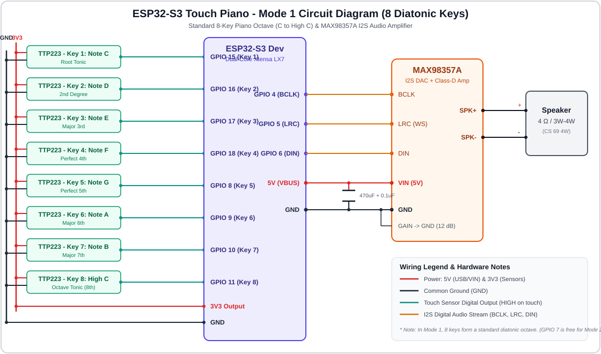
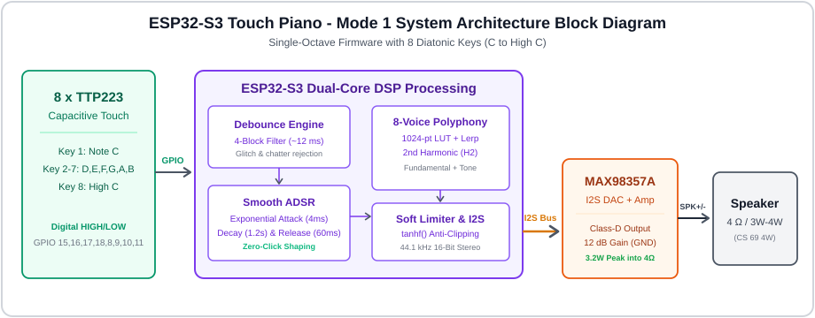
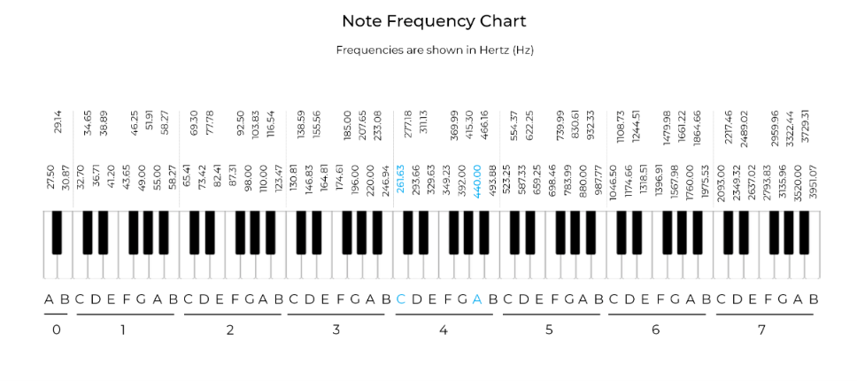
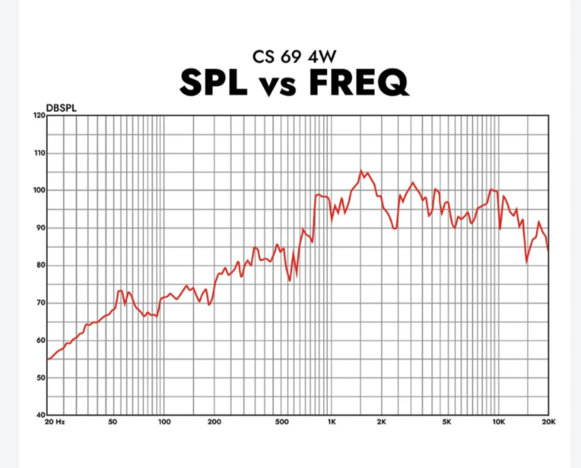
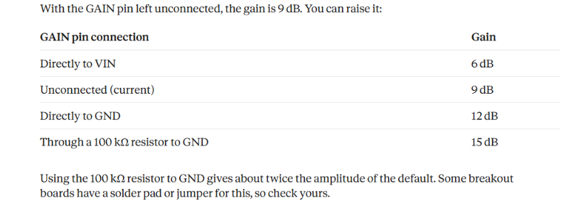

# 🎹 ESP32-S3 Touch Piano - Mode 1 (Individual Octaves)

A high-performance, polyphonic **8-key capacitive touch piano** built using the **ESP32-S3**, **TTP223 touch sensor modules**, and the **MAX98357A I2S Class-D amplifier**. 

In **Mode 1**, seven separate, dedicated Arduino firmware sketches (`piano_octave1` through `piano_octave7`) are provided to test each octave individually. Each sketch provides a complete standard 8-note diatonic octave (C to High C) without unnecessary extra notes.

---

## 📸 System Previews & Diagrams

### 🔌 Circuit Diagram

### 🧩 System Architecture & Block Diagram

---

## 🧰 Hardware Components

| Quantity | Component | Description & Function |
|---|---|---|
| 1 | **ESP32-S3 Dev Module** | Dual-core 240 MHz Xtensa LX7 MCU for DSP synthesis and I2S streaming |
| 8 | **TTP223 Touch Sensors** | Capacitive touch keys (digital HIGH active on touch) |
| 1 | **MAX98357A I2S Amplifier** | Integrated 24-bit DAC and 3.2 W Class-D audio amplifier |
| 1 | **4 Ω / 3W - 4W Speaker** | Audio transducer (CS 69 4W or equivalent) |
| 1 | **470 µF – 1000 µF Capacitor** | Low-frequency power decoupling across amplifier VIN and GND |
| 1 | **0.1 µF Ceramic Capacitor** | High-frequency noise suppression across amplifier VIN and GND |
| - | **Breadboard & Jumper Wires** | Prototyping interconnections |

---

## 📌 Pinout & Wiring Connections

### 1. TTP223 Touch Sensors &rarr; ESP32-S3
Each standard octave consists of **8 diatonic notes** from Root C to High C.

| Key # | Note Degree | Function | ESP32-S3 Pin | Sensor Power |
|:---:|:---:|:---:|:---:|:---:|
| **Key 1** | C | Root Tonic | **GPIO 15** | VCC &rarr; 3V3, GND &rarr; GND |
| **Key 2** | D | 2nd | **GPIO 16** | VCC &rarr; 3V3, GND &rarr; GND |
| **Key 3** | E | Major 3rd | **GPIO 17** | VCC &rarr; 3V3, GND &rarr; GND |
| **Key 4** | F | Perfect 4th | **GPIO 18** | VCC &rarr; 3V3, GND &rarr; GND |
| **Key 5** | G | Perfect 5th | **GPIO 8** | VCC &rarr; 3V3, GND &rarr; GND |
| **Key 6** | A | Major 6th | **GPIO 9** | VCC &rarr; 3V3, GND &rarr; GND |
| **Key 7** | B | Major 7th | **GPIO 10** | VCC &rarr; 3V3, GND &rarr; GND |
| **Key 8** | High C | Octave Tonic | **GPIO 11** | VCC &rarr; 3V3, GND &rarr; GND |

> **Wiring Compatibility Tip:** GPIO 7 is intentionally left unoccupied in Mode 1 so that your hardware breadboard wiring matches Mode 2 (where GPIO 7 is the dedicated octave selector). If you previously wired Key 1 to GPIO 7, simply uncomment the alternate pin array line in the `.ino` sketch.

### 2. MAX98357A I2S Amplifier &rarr; ESP32-S3

| MAX98357A Pin | ESP32-S3 Pin / Power | Function |
|---|---|---|
| **BCLK** | **GPIO 4** | I2S Bit Clock |
| **LRC (WS)** | **GPIO 5** | Word Select (Left/Right Clock) |
| **DIN** | **GPIO 6** | Serial Digital Audio Data |
| **VIN** | **5V (VBUS)** | Power Supply (Use 5V 2A power source) |
| **GND** | **GND** | Common Ground |
| **GAIN** | **GND** | Hardware Gain set to **12 dB** (Recommended) |
| **SD_MODE** | *Unconnected* | Left/Right mix active (Auto-enabled) |

### 3. Speaker Connections
- **SPK+** &rarr; Speaker Positive Terminal
- **SPK-** &rarr; Speaker Negative Terminal
- *Note: The MAX98357A uses bridge-tied load (BTL) output. Never connect SPK+ or SPK- to GND.*

---

## ⚙️ System Workflow

```mermaid
flowchart LR
    A["TTP223 Touch Sensors (x8)"] -->|"Digital Signal"| B["GPIO Sampling & Debounce (12 ms)"]
    B -->|"Key States"| C["ADSR Exponential Envelopes"]
    C -->|"Gain Multipliers"| D["8-Voice Polyphonic Sine Synth (1024-pt LUT)"]
    D -->|"Sample Summation"| E["Soft Limiter (tanhf)"]
    E -->|"16-Bit 44.1 kHz PCM"| F["ESP32-S3 I2S Master Driver"]
    F -->|"Digital I2S Stream"| G["MAX98357A DAC & Amp"]
    G -->|"Analog Audio"| H["4Ω 3W Speaker"]
```

1. **Touch Detection:** When a finger touches a TTP223 capacitive sensor, the module immediately transitions its output from LOW to HIGH.
2. **Debounce Engine:** The ESP32-S3 reads the 8 digital inputs every audio buffer cycle (~2.9 ms). An input must remain stable for 4 consecutive cycles (~12 ms) before a press or release event is confirmed, eliminating false triggers and mechanical bounce.
3. **Envelope Generation:** Each active key drives an independent voice shaped by an exponential Attack-Decay-Sustain-Release (ADSR) envelope. The rapid 4 ms attack curve ensures zero audible clicks or pops upon key contact.
4. **Additive Wave Synthesis:** The sound engine interpolates between samples in a 1024-point precomputed sine table (`tableLerp`) and adds a 2nd harmonic for acoustic warmth.
5. **Soft Limiting:** The voices are summed together and passed through a hyperbolic tangent soft limiter (`tanhf`). Unlike hard digital clipping which introduces harsh odd-harmonic distortion, `tanhf` compresses high amplitudes smoothly, allowing multiple keys to be played simultaneously (polyphony).
6. **Digital Audio Stream:** The processed 16-bit stereo PCM audio is streamed over I2S to the MAX98357A DAC and amplified directly to the speaker.

---

## 🎼 Operating Frequencies of the 7 Octaves

Standard equal-temperament tuning ($A_4 = 440\text{ Hz}$). Each firmware code tests one complete diatonic octave (8 keys):

| Key | Note | Octave 1 (`.ino 1`) | Octave 2 (`.ino 2`) | Octave 3 (`.ino 3`) | Octave 4 (`.ino 4`) | Octave 5 (`.ino 5`) | Octave 6 (`.ino 6`) | Octave 7 (`.ino 7`) |
|:---:|:---:|:---:|:---:|:---:|:---:|:---:|:---:|:---:|
| **1** | **C** | 32.70 Hz | 65.41 Hz | 130.81 Hz | 261.63 Hz | 523.25 Hz | 1046.50 Hz | 2093.00 Hz |
| **2** | **D** | 36.71 Hz | 73.42 Hz | 146.83 Hz | 293.66 Hz | 587.33 Hz | 1174.66 Hz | 2349.32 Hz |
| **3** | **E** | 41.20 Hz | 82.41 Hz | 164.81 Hz | 329.63 Hz | 659.25 Hz | 1318.51 Hz | 2637.02 Hz |
| **4** | **F** | 43.65 Hz | 87.31 Hz | 174.61 Hz | 349.23 Hz | 698.46 Hz | 1396.91 Hz | 2793.83 Hz |
| **5** | **G** | 49.00 Hz | 98.00 Hz | 196.00 Hz | 392.00 Hz | 783.99 Hz | 1567.98 Hz | 3135.96 Hz |
| **6** | **A** | 55.00 Hz | 110.00 Hz | 220.00 Hz | 440.00 Hz | 880.00 Hz | 1760.00 Hz | 3520.00 Hz |
| **7** | **B** | 61.74 Hz | 123.47 Hz | 246.94 Hz | 493.88 Hz | 987.77 Hz | 1975.53 Hz | 3951.07 Hz |
| **8** | **High C** | 65.41 Hz | 130.81 Hz | 261.63 Hz | 523.25 Hz | 1046.50 Hz | 2093.00 Hz | 4186.01 Hz |

---

## 🔊 Speaker Frequency Response Analysis (CS 69 4W)

The sound pressure level (SPL) vs. frequency curve of our **CS 69 4W** speaker reveals three clear acoustic regions:

1. **Sub-Bass & Bass (< 200 Hz):**
   - The SPL is only **55 dB to 72 dB**.
   - Due to the small physical diaphragm and absence of an acoustic sub-woofer enclosure, pure fundamental frequencies in this range produce minimal acoustic displacement. In our firmware, an enhanced 2nd harmonic ($H_2 = 0.35 - 0.40$) is introduced to utilize psychoacoustic "virtual pitch" so notes can still be perceived.
2. **Midrange & Presence (300 Hz – 3,000 Hz):**
   - The SPL rises steeply to **85 dB – 95 dB** and hits an acoustic resonance peak of **105 dB SPL** around **1.3 kHz to 1.5 kHz**.
   - This range offers maximum electrical-to-acoustic efficiency and crystal-clear tonal definition.
3. **High Treble (3 kHz – 10 kHz):**
   - Strong output between **90 dB – 100 dB**, rolling off past 12 kHz.

---

## ⚡ MAX98357A Amplifier Gain Configuration

The gain of the MAX98357A Class-D amplifier is configured through the **GAIN** pin:

| GAIN Pin Wiring | Voltage Gain | Effective Amplification | Operational Note |
|---|:---:|:---:|---|
| Connected directly to **VIN** | **6 dB** | 2.0 &times; | Very low volume; suitable only for high-sensitivity earphones |
| **Unconnected (Floating)** | **9 dB** | 2.8 &times; | Default factory state; moderate volume |
| Connected directly to **GND** | **12 dB** | **4.0 &times;** | **RECOMMENDED BEST SETTING** for 4 Ω 3W/4W speakers |
| Via **100 kΩ Resistor** to GND | **15 dB** | 5.6 &times; | Maximum loudness; prone to USB power sagging & clipping distortion |

---

## 🎯 Engineering Recommendations: Best Gain & Best Octaves

### 🏆 Which Gain is Best?
> **Recommendation: 12 dB (GAIN connected directly to GND)**
- **Why?** At 12 dB, the MAX98357A produces a full, rich 3 W output into a 4 Ω speaker from standard 5V USB power without requiring any external resistor (just bridge the GAIN pin to the adjacent GND pin).
- At 15 dB, peak current demand exceeds 1 A, which frequently causes voltage brownouts on PC USB ports, resulting in audio stuttering and clipping. The 12 dB configuration combined with our firmware soft limiter delivers the ideal balance of maximum loudness and pure, undistorted audio.

### 🎹 Which Octaves are Best for this Speaker?
> **Recommendation: Octave 4 (C4 - C5) and Octave 5 (C5 - C6) [Secondary: Octave 6]**
- **Acoustic Sweet Spot:** The fundamental frequencies of **Octave 4 (261 Hz – 523 Hz)** and **Octave 5 (523 Hz – 1046 Hz)** sit directly at the rising slope of the speaker's frequency response curve (85 dB to 98 dB SPL).
- **Musical Clarity:** Octave 4 is the middle octave of a piano (containing Middle C and Concert Pitch $A_4 = 440\text{ Hz}$). Notes sound natural, warm, and clear without distortion.
- **Maximum Loudness:** If you need the piano to sound as loud as possible, **Octave 6 (1046 Hz – 2093 Hz)** aligns directly with the speaker's peak sensitivity region (**105 dB SPL** at 1.4 kHz).
- *Avoid relying primarily on Octaves 1 and 2 for standalone demonstration, as small speakers cannot reproduce sub-100 Hz bass efficiently.*

---

## 🚀 How to Upload & Test Mode 1 Sketches

1. Open the [Arduino IDE](https://www.arduino.cc/en/software).
2. Install the **ESP32 Board Package (v3.x)** via Boards Manager (`esp32 by Espressif Systems`).
3. Select Board: **ESP32S3 Dev Module**.
4. Choose the octave you wish to test (e.g., `piano_octave4/piano_octave4.ino`).
5. Connect your ESP32-S3 board via USB and select the correct COM port.
6. Click **Upload**.
7. Open the Serial Monitor at **115200 baud** to view real-time key triggers and diagnostic output!
