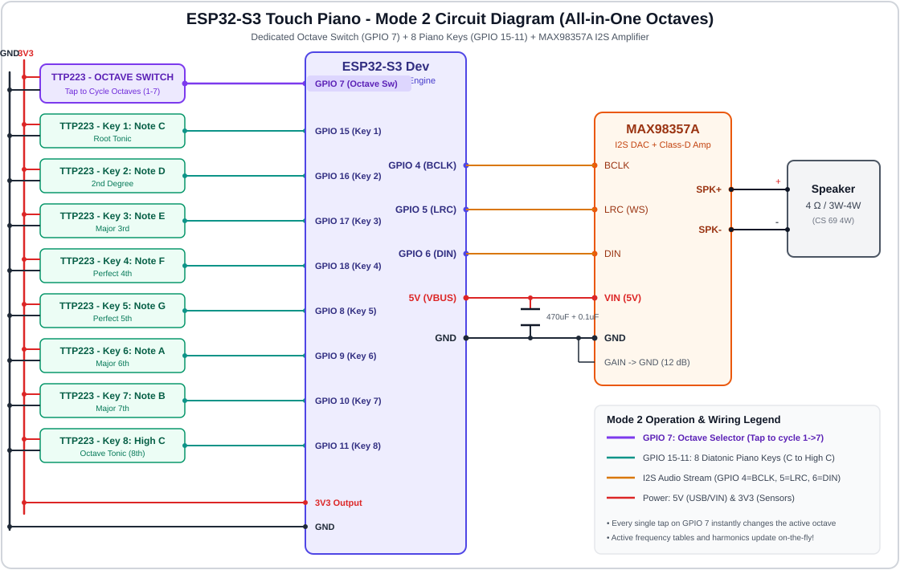
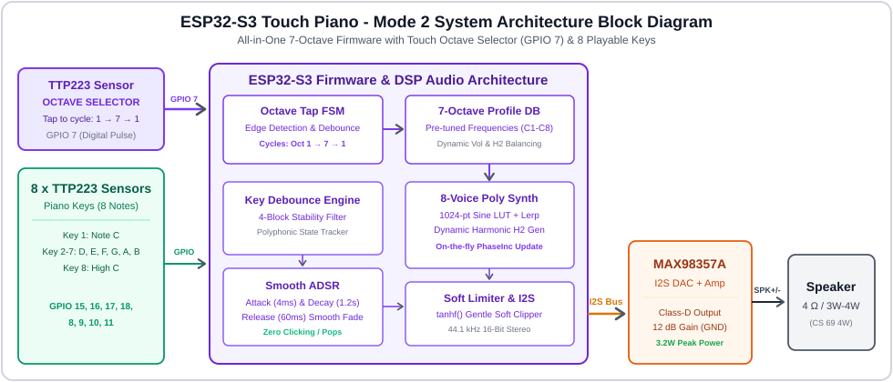
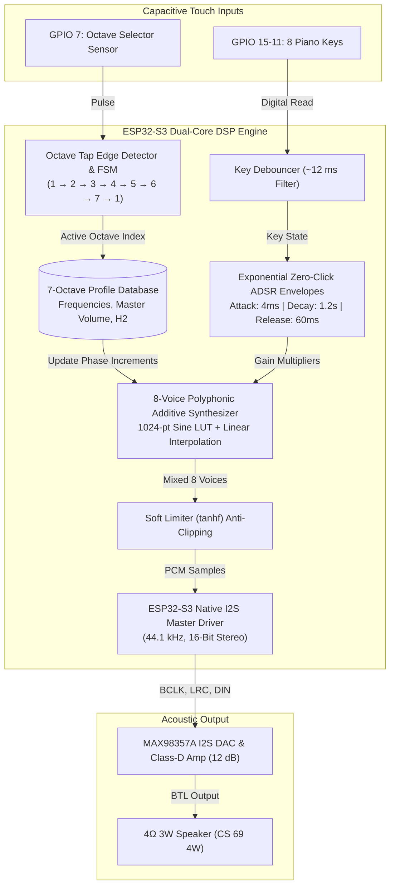
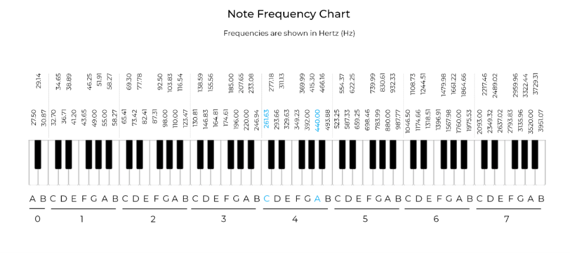
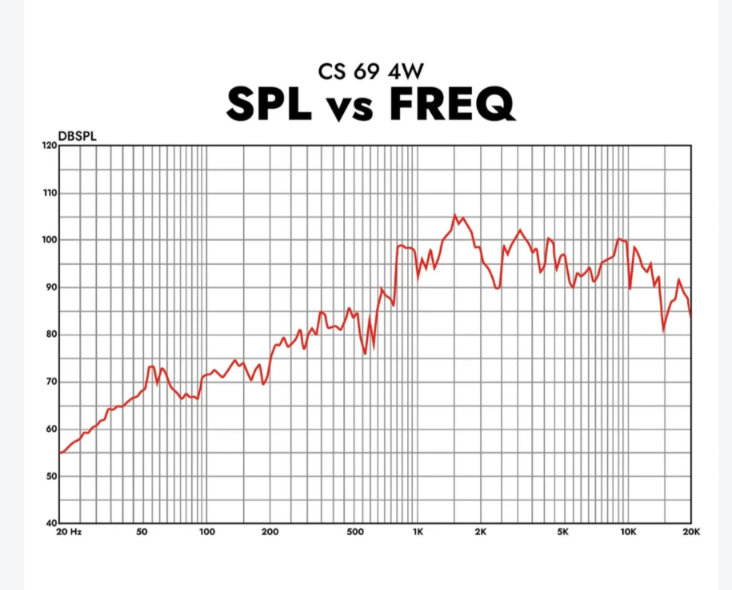
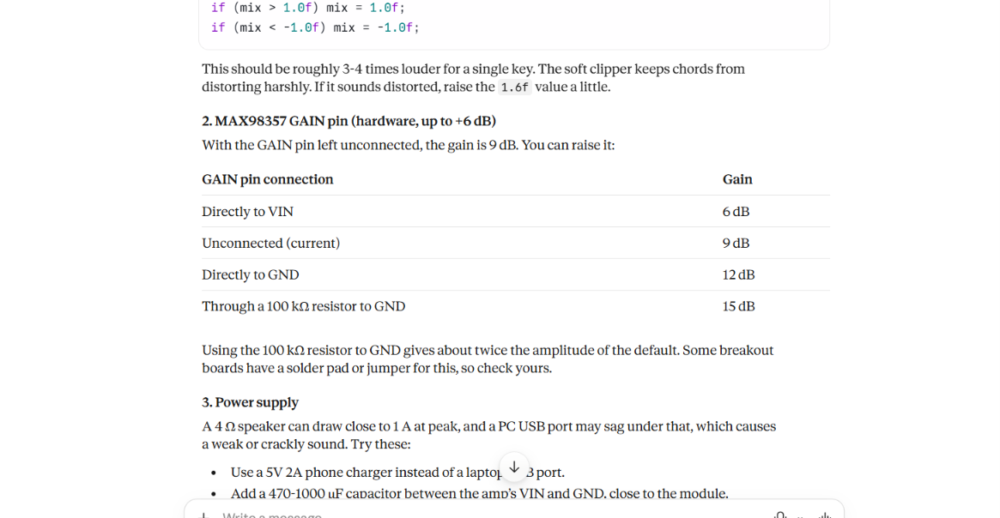

# 🎹 ESP32-S3 Touch Piano - Mode 2 (All-in-One Multi-Octave Engine)

A complete, standalone **7-octave touch synthesizer** built with an **ESP32-S3**, **TTP223 capacitive touch sensors**, and a **MAX98357A I2S Class-D amplifier**.

In **Mode 2**, **all 7 musical octaves** (Octave 1 to Octave 7, spanning 32.70 Hz to 4186.01 Hz) are integrated into a single, unified Arduino firmware. 
- **Touch Sensor on GPIO 7:** Serves as a dedicated **Octave Selector**. Every tap on this pad instantly cycles to the next octave: `1 &rarr; 2 &rarr; 3 &rarr; 4 &rarr; 5 &rarr; 6 &rarr; 7 &rarr; 1...`
- **8 Touch Keys (GPIO 15, 16, 17, 18, 8, 9, 10, 11):** Play the standard diatonic scale (C, D, E, F, G, A, B, High C) of whichever octave is currently active!

---

## 📸 System Previews & Diagrams

### 🔌 Circuit Diagram

### 🧩 System Architecture & Block Diagram

---

## 🧰 Hardware Components

| Quantity | Component | Description & Function |
|---|---|---|
| 1 | **ESP32-S3 Dev Module** | Dual-core 240 MHz Xtensa LX7 MCU executing multi-octave DSP synthesis |
| 1 | **TTP223 Touch Sensor** | **Dedicated Octave Selector** (GPIO 7) |
| 8 | **TTP223 Touch Sensors** | **8 Diatonic Piano Keys** (GPIO 15, 16, 17, 18, 8, 9, 10, 11) |
| 1 | **MAX98357A I2S Amplifier** | High-efficiency 3.2 W Class-D digital audio amplifier |
| 1 | **4 Ω / 3W - 4W Speaker** | Sound output transducer (CS 69 4W) |
| 1 | **470 µF – 1000 µF Capacitor** | Power rail reservoir capacitor across amplifier VIN and GND |
| 1 | **0.1 µF Ceramic Capacitor** | High-frequency bypass capacitor |
| - | **Breadboard & Jumper Wires** | Circuit prototyping interconnections |

---

## 📌 Pinout & Hardware Connections

### 1. Touch Sensors &rarr; ESP32-S3

| Sensor Function | Module | Note / Role | ESP32-S3 Pin | Operation |
|---|:---:|:---:|:---:|---|
| 🔄 **OCTAVE SWITCH** | TTP223 #1 | **Octave Selector** | **GPIO 7** | **Tap once to cycle: 1 &rarr; 2 &rarr; 3 &rarr; 4 &rarr; 5 &rarr; 6 &rarr; 7 &rarr; 1** |
| 🎹 **Piano Key 1** | TTP223 #2 | Note C (Root Tonic) | **GPIO 15** | Plays fundamental root note of active octave |
| 🎹 **Piano Key 2** | TTP223 #3 | Note D (2nd Degree) | **GPIO 16** | Plays 2nd degree of active octave |
| 🎹 **Piano Key 3** | TTP223 #4 | Note E (Major 3rd) | **GPIO 17** | Plays major 3rd of active octave |
| 🎹 **Piano Key 4** | TTP223 #5 | Note F (Perfect 4th) | **GPIO 18** | Plays 4th degree of active octave |
| 🎹 **Piano Key 5** | TTP223 #6 | Note G (Perfect 5th) | **GPIO 8** | Plays 5th degree of active octave |
| 🎹 **Piano Key 6** | TTP223 #7 | Note A (Major 6th) | **GPIO 9** | Plays 6th degree of active octave |
| 🎹 **Piano Key 7** | TTP223 #8 | Note B (Major 7th) | **GPIO 10** | Plays leading tone of active octave |
| 🎹 **Piano Key 8** | TTP223 #9 | Note High C (8th Tonic)| **GPIO 11** | Plays upper octave tonic |

> *All 9 TTP223 sensors share common power connections: **VCC &rarr; 3V3** and **GND &rarr; GND**.*

### 2. MAX98357A I2S Amplifier &rarr; ESP32-S3

| MAX98357A Pin | ESP32-S3 Pin / Power | Role |
|---|---|---|
| **BCLK** | **GPIO 4** | Bit Clock |
| **LRC (WS)** | **GPIO 5** | Word Select (Left/Right Clock) |
| **DIN** | **GPIO 6** | Serial Digital Audio In |
| **VIN** | **5V (VBUS)** | Power (Use 5V &ge; 2A power source) |
| **GND** | **GND** | Common Ground |
| **GAIN** | **GND** | Hardware Gain set to **12 dB** (Recommended) |
| **SD_MODE** | *Unconnected* | Left/Right mixed stereo mode |

### 3. Speaker Connections
- **SPK+** &rarr; Speaker Terminal (+)
- **SPK-** &rarr; Speaker Terminal (-)
- *Never connect speaker terminals to common GND.*

---

## ⚙️ System Workflow

1. **Octave Switching:** Tapping the touch sensor on **GPIO 7** triggers the edge-detection state machine. It increments the octave index (1 &rarr; 7) and wraps back to 1. The firmware updates the voice synthesis phase increments, master volume, and harmonic weight in real time without audio popping.
2. **Key Debouncing:** Every 2.9 ms, the 8 piano keys are read and filtered across 4 consecutive blocks (12 ms) to reject electrical noise.
3. **Smooth Enveloping:** When a key is touched, its voice initiates an exponential attack (4 ms), decays naturally while held, and fades out over 60 ms upon release.
4. **Additive Wave Synthesis:** Each active voice calculates its position in a 1024-point sine lookup table with linear interpolation (`tableLerp`) and mixes a tuned 2nd harmonic for rich acoustic timbre.
5. **Soft Limiting:** The hyperbolic tangent (`tanhf`) compresses summed polyphonic peaks smoothly to prevent digital clipping when multiple keys are struck simultaneously.
6. **I2S Transmission:** Streams pure 44.1 kHz 16-bit stereo audio digitally to the MAX98357A for amplification.

---

## 🎼 Complete 7-Octave Frequency Database

The table below details all 7 octaves available in the firmware:

| Key # | Note Name | Octave 1 (Hz) | Octave 2 (Hz) | Octave 3 (Hz) | Octave 4 (Hz) *(Default)* | Octave 5 (Hz) | Octave 6 (Hz) | Octave 7 (Hz) |
|:---:|:---:|:---:|:---:|:---:|:---:|:---:|:---:|:---:|
| **1** | **C** | 32.70 | 65.41 | 130.81 | **261.63** (Middle C) | 523.25 | 1046.50 | 2093.00 |
| **2** | **D** | 36.71 | 73.42 | 146.83 | **293.66** | 587.33 | 1174.66 | 2349.32 |
| **3** | **E** | 41.20 | 82.41 | 164.81 | **329.63** | 659.25 | 1318.51 | 2637.02 |
| **4** | **F** | 43.65 | 87.31 | 174.61 | **349.23** | 698.46 | 1396.91 | 2793.83 |
| **5** | **G** | 49.00 | 98.00 | 196.00 | **392.00** | 783.99 | 1567.98 | 3135.96 |
| **6** | **A** | 55.00 | 110.00 | 220.00 | **440.00** (Concert A) | 880.00 | 1760.00 | 3520.00 |
| **7** | **B** | 61.74 | 123.47 | 246.94 | **493.88** | 987.77 | 1975.53 | 3951.07 |
| **8** | **High C** | 65.41 | 130.81 | 261.63 | **523.25** | 1046.50 | 2093.00 | 4186.01 |

---

## 🔊 Speaker Frequency Response Analysis (CS 69 4W)

The sound pressure level (SPL) vs. frequency characteristic curve for the **CS 69 4W** speaker demonstrates:
- **Low Frequency Roll-Off (< 200 Hz):** SPL drops to 55 dB – 72 dB. Tiny cones cannot displace sufficient air for deep fundamental bass. Mode 2 compensates by adding acoustic harmonics ($H_2 = 0.40$).
- **Optimum Midband Response (300 Hz – 3 kHz):** SPL rises from 85 dB to 95 dB and peaks at **105 dB SPL** around **1.4 kHz**.
- **High Frequency Band (3 kHz – 10 kHz):** Steady response around 90 dB – 100 dB, delivering crisp high notes.

---

## ⚡ MAX98357A Amplifier Gain Configuration

| GAIN Pin Connection | Gain (dB) | Gain Multiplier | Behavior & Power Characteristics |
|---|:---:|:---:|---|
| Directly to **VIN** | **6 dB** | 2.0 &times; | Safe, quiet volume; ideal for night-time testing |
| **Unconnected (Floating)** | **9 dB** | 2.8 &times; | Default unpopulated state |
| Directly to **GND** | **12 dB** | **4.0 &times;** | **RECOMMENDED OPTIMUM** for 4 Ω 3W/4W speakers |
| **100 kΩ Resistor** to GND | **15 dB** | 5.6 &times; | Highest gain; risk of USB current sag (>1 A peak) and distortion |

---

## 🎯 Engineering Recommendations: Best Gain & Best Octaves

### 🏆 Best Amplifier Gain: 12 dB (GAIN &rarr; GND)
- **Why?** Connecting GAIN directly to GND configures **12 dB gain**. This drives the 4 Ω speaker to its full 3W rating cleanly. It avoids the need for external resistors and avoids the severe USB voltage sag and clipping common at 15 dB.

### 🎹 Best Octaves for Our Speaker: Octave 4 & Octave 5 (Secondary: Octave 6)
- **Octave 4 (261.63 Hz – 523.25 Hz):** **Best Musical Balance.** The standard central piano octave (Middle C to C5). Warm, natural, and free from distortion.
- **Octave 5 (523.25 Hz – 1046.50 Hz):** **Best Projection.** Sits right at the transition to peak sensitivity; bright, punchy, and highly intelligible.
- **Octave 6 (1046.50 Hz – 2093.00 Hz):** **Maximum Loudness.** Directly overlaps the speaker's peak sensitivity region (**105 dB SPL** at 1.4 kHz).
- *Octaves 1 & 2 are great for testing sub-bass harmonics, while Octave 7 provides high-frequency treble brilliance.*

---

## 🚀 How to Upload & Use Mode 2

1. Launch the **Arduino IDE**.
2. Ensure the **ESP32 Board Package (v3.x)** is installed.
3. Select Board: **ESP32S3 Dev Module**.
4. Open `piano_all_octaves_touch_select.ino`.
5. Connect your ESP32-S3 board and select the appropriate serial port.
6. Click **Upload**.
7. Open the Serial Monitor at **115200 baud**.
8. **Playing the Piano:**
   - Touch any of the 8 keys (GPIO 15-11) to play notes in the current octave.
   - Tap the touch sensor on **GPIO 7** to switch octaves on-the-fly! The Serial Monitor will report the active octave, note frequencies, and gain parameters.
